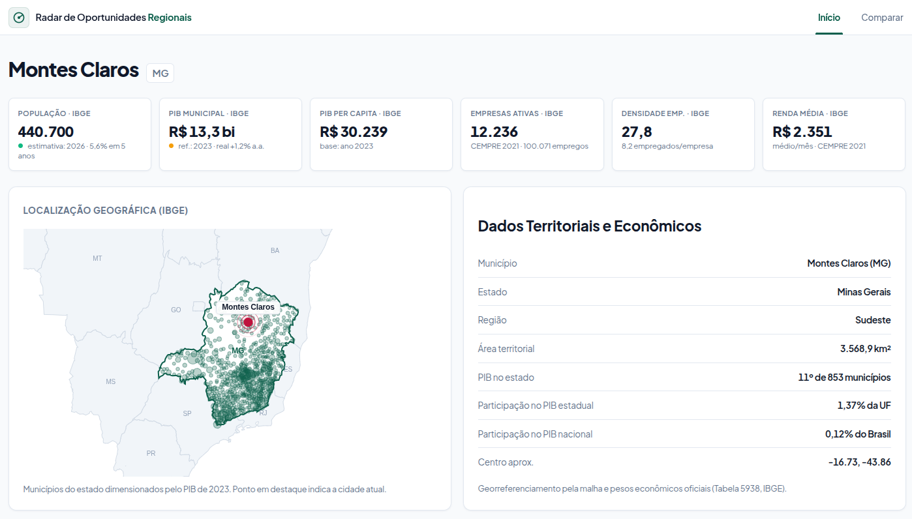
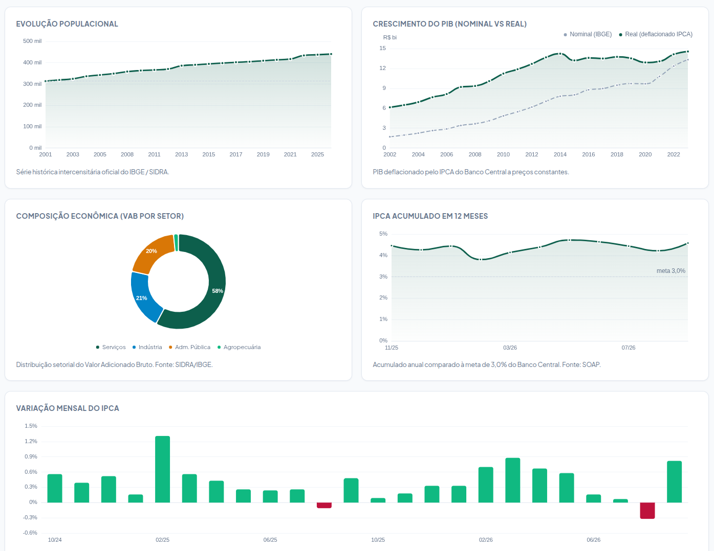
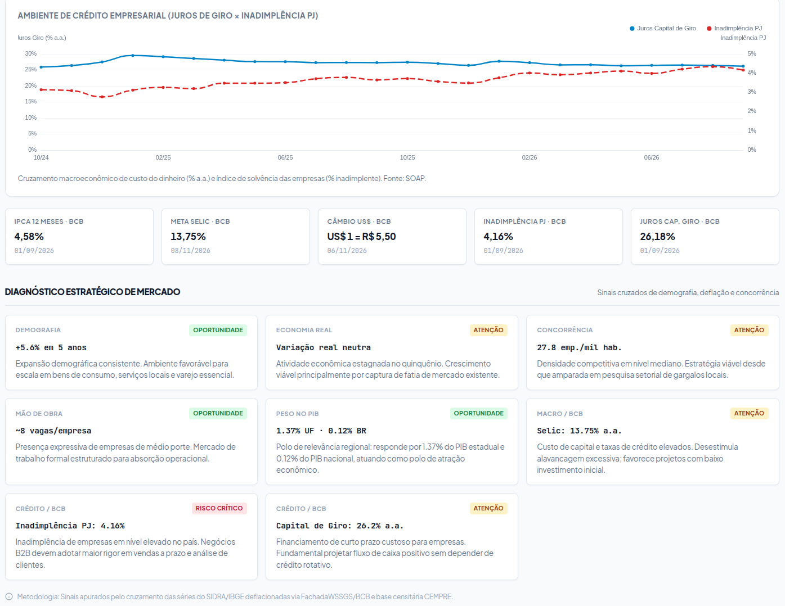
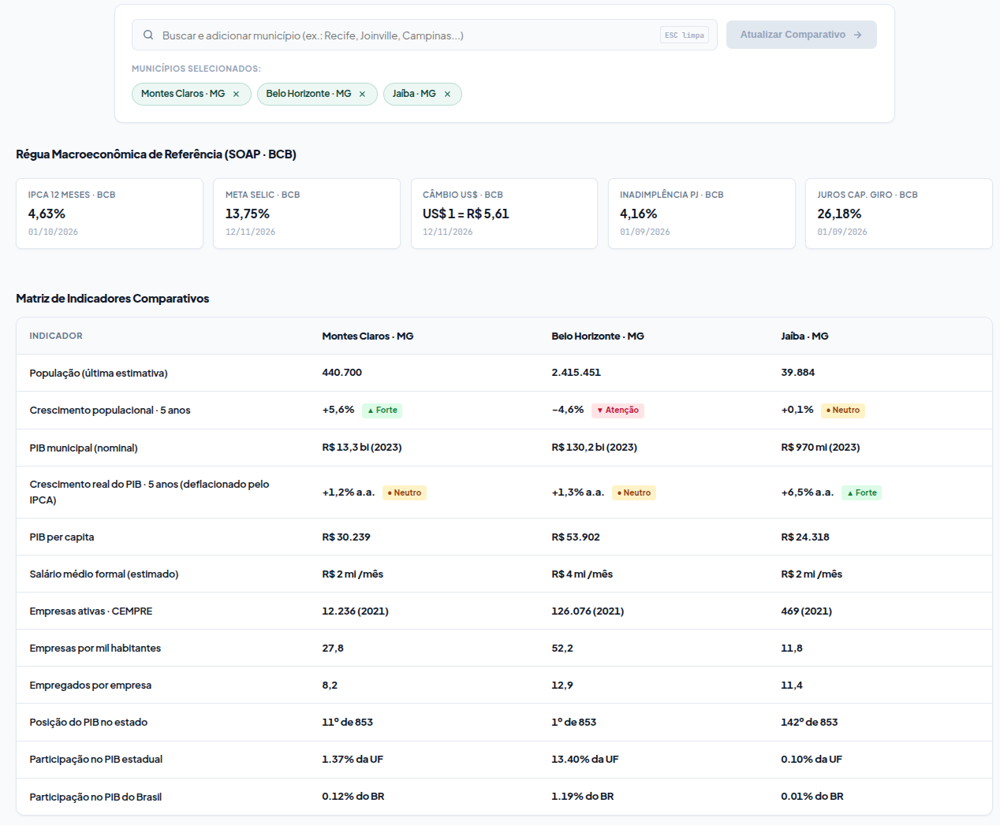
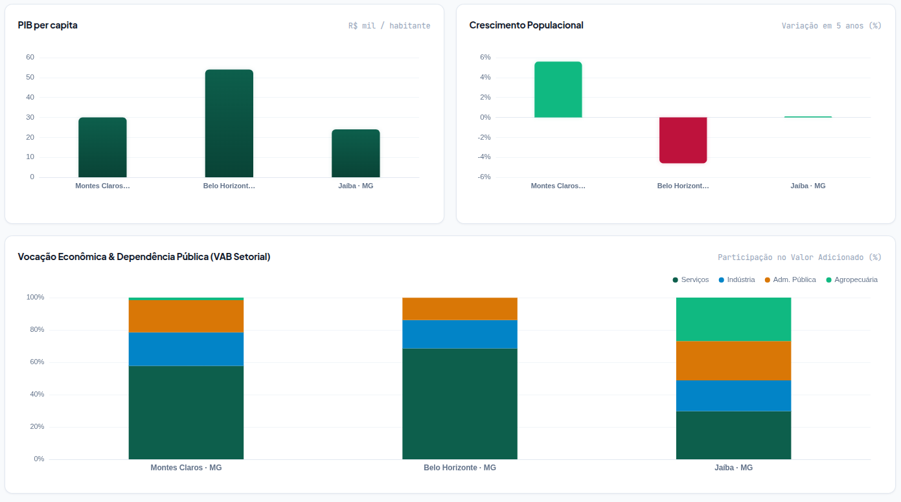

# Radar de Oportunidades Regionais


Sistema de investigação econômica por município: o usuário escolhe uma cidade e
recebe indicadores, evolução histórica, comparativo entre municípios e
**pontos de atenção para novos negócios**.

## Como rodar

```bash
python3 -m venv .venv
.venv/bin/pip install -r requirements.txt
.venv/bin/python run.py          # http://127.0.0.1:8000
```

## Interface do Sistema

### 1. Painel do Município — Indicadores Gerais e Evolução Histórica
Apresentação dos principais indicadores econômicos.



### 2. Composição Setorial e Ambiente Macroeconômico
Detalhamento do Valor Adicionado Bruto (VAB) por setor (Agropecuária, Indústria, Serviços e Administração Pública) integrado aos dados macroeconômicos do Banco Central obtidos via SOAP (IPCA). Contém evolução demográfica e crescimento real do PIB municipal deflacionado pelo IPCA.



### 3. Diagnóstico Estratégico de Mercado e Mapa Territorial
Painel de heurísticas automatizadas com classificação por cores (Oportunidade, Atenção e Risco) para orientar decisões de novos negócios, acompanhado da malha geográfica vetorial do estado e destaque do município pesquisado. Contém dados macroeconômicos do Banco Central obtidos via SOAP (Selic, IPCA, juros de capital de giro e taxa de inadimplência PJ).




### 4. Módulo de Comparação e Benchmarking Municipal
Tela de análise comparativa simultânea (de 2 a 4 municípios) com tabelas de benchmarking.




### 5. Módulo de Comparação com Gráficos

Gráficos comparativos de PIB per capita, evolução populacional e estrutura setorial sobreposta.




## Rotas

| Rota | Papel |
|---|---|
| `/` | Página inicial (busca por município com polos em destaque) |
| `/municipio/{id}` | Painel analítico completo do município (PIB real, demografia, VAB setorial) |
| `/comparar?ids=1,2,3` | Comparador de benchmarking direto entre 2 a 4 municípios |
| `/api/monitor` | API de auditoria em tempo real das requisições REST e SOAP trafegadas |

## Integrações

| Protocolo | Fonte | O que traz |
|---|---|---|
| **REST/API** | IBGE — Localidades (`/api/v1/localidades`) | Catálogo dos 5.570 municípios, UFs e hierarquias regionais |
| **REST/API** | IBGE — SIDRA (`apisidra.ibge.gov.br`) | Séries censitárias: t6579 (população), t5938 (PIB e VAB setorial), t6449 (empresas, empregos e salários do CEMPRE) |
| **REST/API** | IBGE — Malhas Geográficas (`/api/v3/malhas`) | Fronteiras territoriais em GeoJSON do Brasil, UFs e municípios para os mapas vetoriais |
| **SOAP** | Banco Central — FachadaWSSGS (`/wssgs/services/FachadaWSSGS`) | IPCA mensal (433), IPCA 12m (13522), Meta Selic (432), Câmbio (1), Inadimplência PJ (21086), Juros Capital de Giro (20749) |
| **REST (Fallback)** | Banco Central — SGS REST (`api.bcb.gov.br/dados/serie`) | Mecanismo de tolerância a falhas: reserva automática caso o endpoint SOAP esteja fora do ar |

O serviço SOAP usa envelope `rpc/encoded` do Apache Axis 1.2 (2005), com
`soapenc:Array` sem modelo de conteúdo e referências `multiRef` (id/href)
recorrentes — serializers automáticos quebram nesse formato (zeep falha no
`ArrayOflong`). Por isso o cliente SOAP em `app/services/bcb.py` constrói o
envelope à mão e resolve o grafo de referências com um walker recursivo.

Se o endpoint SOAP estiver fora, o sistema degrada para a API REST legada do
SGS e **marca a fonte na tela** (`SOAP` / `REST`).

## Padrão de Comunicação (Enviado / Recebido)

A aplicação conta com um monitor de auditoria interno (`/api/monitor` ou pelo botão flutuante de terminal) que intercepta e registra a troca exata de mensagens em ambos os protocolos.

### 1. Comunicação REST — IBGE SIDRA (Séries Estatísticas)

* **Finalidade:** Obter dados censitários e econômicos anuais por município.
* **Exemplo:** Consulta do PIB municipal a preços correntes de Montes Claros · MG (Código IBGE: `3143302`, Tabela `5938`, Variável `37`).

**Enviado (HTTP GET Request):**
```http
GET /values/t/5938/n6/3143302/v/37?formato=json
Host: apisidra.ibge.gov.br
User-Agent: radar-oportunidades/1.0
```

**Recebido (HTTP 200 OK — JSON):**
```json
[
  {
    "NC": "Nível Territorial (Código)",
    "NN": "Nível Territorial",
    "MC": "Unidade de Medida (Código)",
    "MN": "Unidade de Medida",
    "V": "Valor",
    "D1C": "Ano (Código)",
    "D1N": "Ano",
    "D2C": "Variável (Código)",
    "D2N": "Variável",
    "D3C": "Município (Código)",
    "D3N": "Município"
  },
  {
    "NC": "6",
    "NN": "Município",
    "MC": "1000",
    "MN": "Mil Reais",
    "V": "13328456",
    "D1C": "2023",
    "D1N": "2023",
    "D2C": "37",
    "D2N": "Produto Interno Bruto a preços correntes",
    "D3C": "3143302",
    "D3N": "Montes Claros - MG"
  }
]
```

**Dicionário de Atributos do JSON (Padrão SIDRA/IBGE):**

Na API SIDRA, o primeiro elemento (`[0]`) serve como cabeçalho de metadados, e os elementos seguintes (`[1..n]`) trazem os registros de dados. O sufixo **`C`** indica **Código** e **`N`** indica **Nome**:

| Atributo | Significado | Exemplo no registro | Descrição |
|---|---|---|---|
| **`NC`** | Nível Territorial (Código) | `"6"` | Código da escala geográfica do IBGE (`6` = Município, `3` = UF, `1` = Brasil). |
| **`NN`** | Nível Territorial (Nome) | `"Município"` | Descrição do nível geográfico apurado. |
| **`MC`** | Unidade de Medida (Código) | `"1000"` | Identificador da unidade de medida do dado. |
| **`MN`** | Unidade de Medida (Nome) | `"Mil Reais"` | Unidade do valor apurado (ex.: Mil Reais, Pessoas, %). |
| **`V`** | Valor | `"13328456"` | O dado numérico oficial apurado (ex.: R$ 13.328.456 mil = ~R$ 13,3 bilhões). |
| **`D1C`** | Dimensão 1 (Código) | `"2023"` | Código do ano de referência do levantamento. |
| **`D1N`** | Dimensão 1 (Nome) | `"2023"` | Descrição do ano de referência. |
| **`D2C`** | Dimensão 2 (Código) | `"37"` | Código da variável pesquisada no SIDRA. |
| **`D2N`** | Dimensão 2 (Nome) | `"Produto Interno Bruto..."` | Nome completo da variável (`PIB a preços correntes`). |
| **`D3C`** | Dimensão 3 (Código) | `"3143302"` | Código IBGE único de 7 dígitos do município (Montes Claros). |
| **`D3N`** | Dimensão 3 (Nome) | `"Montes Claros - MG"` | Nome oficial da cidade seguido da sigla da Unidade Federativa. |

---

### 2. Comunicação REST — IBGE Localidades (Catálogo e Hierarquia)

* **Finalidade:** Obter os 5.570 municípios para autocomplete e metadados territoriais (região imediata, intermediária, mesorregião e estado).
* **Exemplo:** Busca dos dados cadastrais de Montes Claros · MG.

**Enviado (HTTP GET Request):**
```http
GET /api/v1/localidades/municipios/3143302
Host: servicodados.ibge.gov.br
User-Agent: radar-oportunidades/1.0
```

**Recebido (HTTP 200 OK — JSON):**
```json
{
  "id": 3143302,
  "nome": "Montes Claros",
  "microrregiao": {
    "id": 31024,
    "nome": "Montes Claros",
    "mesorregiao": {
      "id": 3102,
      "nome": "Norte de Minas",
      "UF": {
        "id": 31,
        "sigla": "MG",
        "nome": "Minas Gerais",
        "regiao": {
          "id": 3,
          "sigla": "SE",
          "nome": "Sudeste"
        }
      }
    }
  },
  "regiao-imediata": {
    "id": 310043,
    "nome": "Montes Claros",
    "regiao-intermediaria": {
      "id": 3108,
      "nome": "Montes Claros",
      "UF": {
        "id": 31,
        "sigla": "MG",
        "nome": "Minas Gerais"
      }
    }
  }
}
```

---

### 3. Comunicação REST — IBGE Malhas Geográficas (Polígonos Espaciais)

* **Finalidade:** Fornecer as geometrias em GeoJSON das fronteiras do Brasil, das UFs e dos municípios para plotagem dos mapas interativos pelo Apache ECharts.
* **Exemplo:** Malha vetorial do município de Montes Claros · MG.

**Enviado (HTTP GET Request):**
```http
GET /api/v3/malhas/municipios/3143302?formato=application/vnd.geo+json
Host: servicodados.ibge.gov.br
User-Agent: radar-oportunidades/1.0
```

**Recebido (HTTP 200 OK — GeoJSON):**
```json
{
  "type": "FeatureCollection",
  "features": [
    {
      "type": "Feature",
      "geometry": {
        "type": "Polygon",
        "coordinates": [
          [
            [-43.856, -16.489],
            [-43.782, -16.512],
            [-43.641, -16.634],
            [-43.856, -16.489]
          ]
        ]
      },
      "properties": {
        "codarea": "3143302"
      }
    }
  ]
}
```

---

### 4. Comunicação SOAP — Banco Central (FachadaWSSGS)

* **Finalidade:** Obter séries macroeconômicas oficiais (ex.: IPCA mensal `433` para deflação do PIB, Meta Selic `432`, Juros de Capital de Giro `20749`, Inadimplência PJ `21086`).
* **Padrão:** SOAP 1.1 / WSDL RPC-Encoded (Apache Axis 1.2 com grafo `multiRef`).

**Enviado (SOAP Request — Envelope XML):**
```xml
POST /wssgs/services/FachadaWSSGS HTTP/1.1
Host: www3.bcb.gov.br
Content-Type: text/xml;charset=UTF-8
SOAPAction: getUltimoValorVO

<soapenv:Envelope 
    xmlns:soapenv="http://schemas.xmlsoap.org/soap/envelope/" 
    xmlns:ser="https://www3.bcb.gov.br/wssgs/services/FachadaWSSGS" 
    xmlns:soapenc="http://schemas.xmlsoap.org/soap/encoding/" 
    xmlns:xsd="http://www.w3.org/2001/XMLSchema" 
    xmlns:xsi="http://www.w3.org/2001/XMLSchema-instance">
  <soapenv:Body>
    <ser:getUltimoValorVO soapenv:encodingStyle="http://schemas.xmlsoap.org/soap/encoding/">
      <in0 xsi:type="xsd:long">433</in0>
    </ser:getUltimoValorVO>
  </soapenv:Body>
</soapenv:Envelope>
```

**Recebido (SOAP Response — Envelope XML com referências `multiRef`):**
```xml
<soapenv:Envelope 
    xmlns:soapenv="http://schemas.xmlsoap.org/soap/envelope/" 
    xmlns:xsd="http://www.w3.org/2001/XMLSchema" 
    xmlns:xsi="http://www.w3.org/2001/XMLSchema-instance">
  <soapenv:Body>
    <ns1:getUltimoValorVOResponse 
        xmlns:ns1="https://www3.bcb.gov.br/wssgs/services/FachadaWSSGS" 
        soapenv:encodingStyle="http://schemas.xmlsoap.org/soap/encoding/">
      <getUltimoValorVOReturn href="#id0"/>
    </ns1:getUltimoValorVOResponse>
    
    <!-- Nó principal da série com ponteiros href para tipos derivados -->
    <multiRef id="id0" 
        soapenc:root="0" 
        soapenv:encodingStyle="http://schemas.xmlsoap.org/soap/encoding/" 
        xsi:type="ns2:WSSerieVO" 
        xmlns:soapenc="http://schemas.xmlsoap.org/soap/encoding/" 
        xmlns:ns2="http://comum.ws.casosdeuso.sgs.pec.bcb.gov.br">
      <nomeCompleto xsi:type="soapenc:string">Índice nacional de preços ao consumidor-amplo (IPCA)</nomeCompleto>
      <periodicidade xsi:type="soapenc:string">Mensal</periodicidade>
      <unidadePadrao xsi:type="soapenc:string">Var. % mensal</unidadePadrao>
      <ultimoValor href="#id11"/>
    </multiRef>

    <!-- Valor pontual resolvido via href -->
    <multiRef id="id11" 
        soapenc:root="0" 
        soapenv:encodingStyle="http://schemas.xmlsoap.org/soap/encoding/" 
        xsi:type="ns3:WSValorSerieVO" 
        xmlns:soapenc="http://schemas.xmlsoap.org/soap/encoding/" 
        xmlns:ns3="http://comum.ws.casosdeuso.sgs.pec.bcb.gov.br">
      <ano href="#id13"/>
      <mes href="#id19"/>
      <dia href="#id17"/>
      <svalor xsi:type="soapenc:string">0.82</svalor>
    </multiRef>

    <multiRef id="id13" xsi:type="xsd:int">2026</multiRef>
    <multiRef id="id19" xsi:type="xsd:int">10</multiRef>
    <multiRef id="id17" xsi:type="xsd:int">1</multiRef>
  </soapenv:Body>
</soapenv:Envelope>
```

---

### 5. Comunicação REST — Banco Central (Fallback de Tolerância a Falhas)

* **Finalidade:** Reserva automática acionada quando o WebService SOAP do Banco Central estiver indisponível ou sofrer timeout.
* **Exemplo:** Consulta direta do histórico mensal do IPCA (`Série 433`).

**Enviado (HTTP GET Request):**
```http
GET /dados/serie/bcdata.sgs.433/dados?formato=json&dataInicial=01/01/2026&dataFinal=01/11/2026
Host: api.bcb.gov.br
User-Agent: radar-oportunidades/1.0
```

**Recebido (HTTP 200 OK — JSON):**
```json
[
  {
    "data": "01/09/2026",
    "valor": "0.44"
  },
  {
    "data": "01/10/2026",
    "valor": "0.56"
  }
]
```

## Motor de análise

1. **População** — evolução estimada anual (SIDRA t6579) → crescimento em
   janela de 5 anos.
2. **PIB real** — o PIB municipal nominal (t5938, mil R$) é deflacionado pelo
   **IPCA real do BCB via SOAP** → crescimento real ≙ economia de verdade,
   sem o efeito dos preços. O deflator age com índice cumulativo mensal até o
   dezembro do último ano completo.
3. **Saturação de mercado** — empresas ativas (CEMPRE t6449) por mil
   habitantes e empregados por empresa.
4. **Posição estadual** — ranking de PIB do município dentro da própria UF
   (busca em lote de todas as unidades do estado no SIDRA).
5. **Contexto financeiro (SOAP)** — IPCA 12m, Selic meta, câmbio; alimentam
   cards e heurísticas.
6. **Pontos de atenção** — heurísticas com tags `potencial`/`atenção`/`risco`
   por tipo de empreendimento (demografia, economia real, concorrência, mão
   de obra, posição estadual, inflação e juro — `app/analysis/insights.py`).

## Estrutura

```
.
├── run.py                 Ponto de entrada do servidor (valida ambiente e inicia Uvicorn)
├── requirements.txt       Dependências do projeto
├── README.md              Documentação técnica e guia do sistema
├── assets/                Capturas de tela da interface do sistema
└── app/
    ├── main.py            Rotas FastAPI, filtros pt-BR e orquestração de visualizações
    ├── config.py          Endpoints, códigos das séries SGS e TTLs de cache
    ├── services/
    │   ├── ibge.py        Cliente REST — Localidades, SIDRA e Malhas do IBGE
    │   ├── bcb.py         Cliente SOAP — FachadaWSSGS (com walker multiRef) + Fallback REST
    │   ├── monitor.py     Auditoria em memória de requisições enviadas/recebidas
    │   └── cache.py       Mecanismo de cache assíncrono com TTL
    ├── analysis/
    │   ├── indicators.py  Cálculo de taxas, CAGR, deflator IPCA e painel de indicadores
    │   ├── insights.py    Motor de heurísticas (Diagnóstico Estratégico de Mercado)
    │   └── painel.py      Montagem agregada das visões municipais e comparativas
    └── ui/
        ├── templates/     Templates Jinja2 com SSR (index, municipio, comparar, base)
        └── static/        CSS do Design System + bibliotecas locais (ECharts sem CDN)
```

## Notas de robustez

* O SIDRA **alterna a ordem das dimensões** (D2↔D3) entre respostas; as
  colunas são mapeadas pelo cabeçalho, não pela posição (`mapear_dimensoes`).
* A janela SOAP que não possui pontos (ex.: IPCA de outubro ainda não
  publicado) dispara `Fault "Value(s) not found"` — tratada como série vazia
  e suprida pela reserva REST.
* Empresas e população são de bases com defasagens diferentes — cada medida
  exibe o próprio ano de referência.
